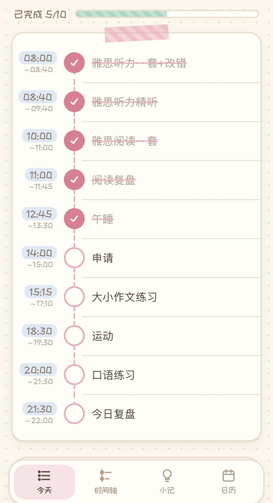
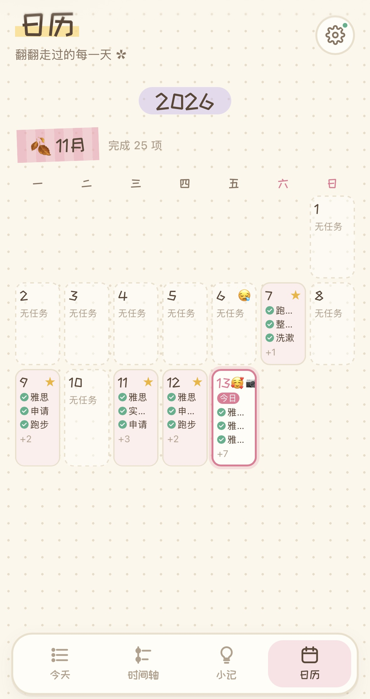
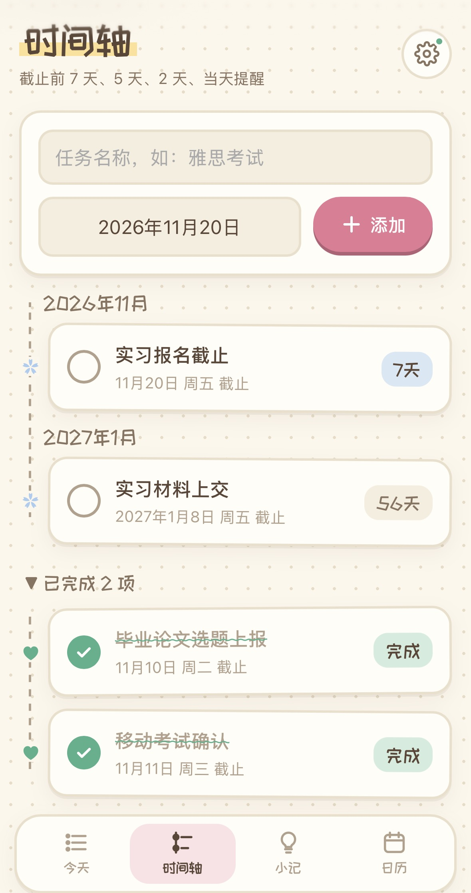
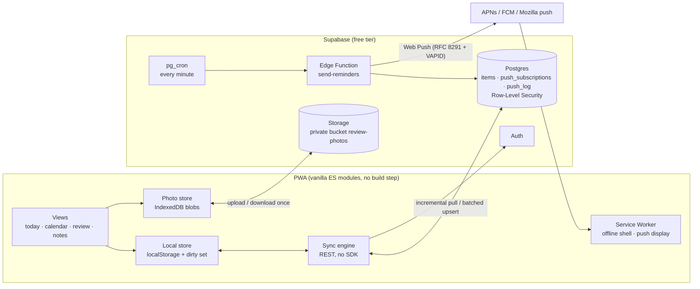

# Rishi (日拾) — an offline-first daily planner & journal PWA

> A zero-dependency Progressive Web App I built for my own daily routine: plan the day, keep weekly habits, track deadlines and write a short evening review. It works offline, syncs across iPhone, iPad and Mac, and sends **server-side reminders at 07:30 and 23:00 even when the app is closed** — all on free tiers.

**Language:** English | [简体中文](README.zh-CN.md)

    

<table>
  <tr>
    <td></td>
    <td></td>
    <td></td>
    <td></td>
  </tr>
  <tr>
    <td align="center">Today</td><td align="center">Evening review</td><td align="center">Calendar</td><td align="center">Deadlines</td>
  </tr>
</table>

---

## Why I built it

I prepare for exams, applications and my graduation project at the same time, and I wanted one place that matches how I actually plan: write the whole day in one go, keep recurring habits without re-typing them, get nudged in the morning and at night, and look back at what I did. Existing apps were either too heavy or did not sync well across my phone, tablet and laptop, so I built my own.

## Features

| Area | What it does |
|---|---|
| **Today** | Type the whole day at once (one task per line, time optional); tasks become a timeline sorted by time; tick to complete |
| **Weekly habits** | Recurring tasks by weekday and time range; edit just one day, skip a day, mark a rest day, pause for a period; changing the schedule only affects the future |
| **Deadlines** | A countdown timeline; reminders 7, 5 and 2 days before and on the day |
| **Evening review** | Mood, "how today felt", "mistakes", "a note to tomorrow" (autosaved), plus up to 3 photos |
| **Notes** | Ideas with a status lifecycle (open → feasible / done / revised / dropped) and quick to-dos; either can be scheduled onto a day |
| **Calendar** | Monday-first month grid, newest month on top; per-day task preview, mood and 📷 markers |
| **Reminders** | Server push at 07:30 (today's tasks + deadlines) and 23:00 (unfinished tasks + review nudge), per-user time zone |
| **Accounts** | Email sign-up, password reset, multi-device sync, self-service account deletion |

## Architecture



## Technical highlights

### 1. Offline-first sync without an SDK

All user data lives in **one generic table** — `items(id, type, data jsonb, updated_at, deleted, server_updated_at)` — so new features (habits, notes, reviews, photos) never need a schema migration.

- **Local first.** Every change is written to `localStorage` immediately and its id is added to a *dirty set*; the UI never waits for the network.
- **Push.** Dirty rows are sent in batches of 200 with `upsert … on conflict (id)`; ids are client-generated UUIDs, so offline creation never collides.
- **Incremental pull.** A Postgres trigger stamps every write with `server_updated_at = clock_timestamp()`. Clients pull only rows newer than their last cursor. The cursor uses *server* time on purpose — device clocks cannot be trusted to be monotonic across devices.
- **Deletes are tombstones** (`deleted = true`) so that a deletion on one device reaches the others.
- **Conflict resolution** is record-level last-write-wins on `updated_at`.
- **Account switching** on a shared device: local data that belongs to another account is cleared instead of being uploaded into the new one.
- Sync runs 1.5 s after a local change, on returning to the foreground, on reconnect and every 60 s.

### 2. Scheduled Web Push, implemented from the RFCs

Reminders that rely on the page being open are unreliable on phones, so they are sent from the server.

- `pg_cron` calls the Edge Function every minute (authenticated with a shared `x-cron-secret`).
- For each user the function computes the **local time in that user's time zone** (`Intl.DateTimeFormat`), decides whether a morning or night reminder is due, and builds the message from the same task rules as the client.
- **Exactly once per day:** before sending, it inserts `(user_id, kind, day)` into `push_log`, whose primary key makes the insert a lock — `on conflict do nothing` means only the first invocation wins, even if two runs overlap.
- **No push library:** payload encryption (**RFC 8291**, `aes128gcm`: ECDH P-256 → HKDF → AES-128-GCM) and server authentication (**RFC 8292 VAPID**, ES256-signed JWT) are written directly against WebCrypto, so the function runs on Deno with zero dependencies.
- Expired subscriptions (HTTP 404/410 from the push service) are deleted automatically.
- Without push permission the app falls back to in-page reminders, and it suppresses them when server push is on so the user never gets the same reminder twice.

### 3. Recurring tasks that keep their history

A weekly habit is a *template* (`days`, `time`, `from`, `until`, `pauseFrom/To`). Its occurrence on a given date is computed, not stored; only deviations are stored as an override row with id `fx|<template>|<date>`.

- An override stores **only the fields that differ** from the template, so later template edits still flow into the fields the user did not change.
- Deleting a habit from one day's edit view writes `skipped: true` for that day only.
- **Changing the schedule never rewrites history:** if the template already has past occurrences, it is split at the effective date — the old one gets `until = effective − 1`, a new one starts at `effective` — so completed past days keep their original title and status.
- Rest days and pause windows suppress all habits without touching one-off tasks.

### 4. Review photos within a 1 GB free quota

- Photos are resized on the device to ≤ 1280 px and encoded as **WebP** (JPEG fallback where Safari cannot encode WebP), typically 100–200 KB.
- They are stored first in **IndexedDB**, so they display offline, and uploaded in the background to a **private** bucket under `<user-id>/<photo-id>.<ext>`.
- Each device downloads each photo **once** and then serves it locally, keeping egress far below the 5 GB/month free limit.
- Deletions are queued and replayed when online; because storage objects are not cascaded when an account is deleted, the app removes all of a user's photos before deleting the account.

### 5. Security model

- **Row-Level Security on every table**; an insert/update trigger overwrites `user_id` with `auth.uid()`, so a client cannot write into someone else's rows even by forging the field.
- Privileged operations (`delete_my_account`, `save_push_subscription`) are `SECURITY DEFINER` functions with `EXECUTE` revoked from `public` / `anon`.
- `push_log` has RLS enabled and no policies — only the server (service role) can read or write it.
- Storage policies restrict every operation to the caller's own folder (`storage.foldername(name)[1] = auth.uid()`).
- The browser only ever holds the publishable key; the service-role key and VAPID private key exist only as Edge Function secrets.
- A Content-Security-Policy (`script-src 'self'`) blocks injected scripts; all user text is HTML-escaped before rendering.

### 6. Zero dependencies, zero cost

Native ES modules, no bundler, no `npm install`. Hosting is static (Netlify); backend, auth, storage, cron and functions run on Supabase's free tier. The trade-offs are listed under *Limitations*.

## Tech stack

| Layer | Technology |
|---|---|
| Client | HTML, CSS, vanilla JavaScript (ES modules), Service Worker, Web Push API, IndexedDB, Canvas |
| Backend | Supabase: Postgres + Row-Level Security, Auth, Storage, Edge Functions (Deno, TypeScript), pg_cron, pg_net |
| Hosting | Netlify (static) |
| Tests | `node:test` (built into Node.js) |

## Project structure

```
├── index.html, styles.css, manifest.webmanifest, sw.js, _headers
├── js/
│   ├── app.js        routing, event delegation, modals
│   ├── views.js      HTML rendering for every page
│   ├── store.js      local data store + domain logic (habits, deadlines, reviews)
│   ├── sync.js       auth + sync engine (Supabase REST, no SDK)
│   ├── photos.js     photo compression, IndexedDB cache, Storage upload
│   ├── push.js       push subscription management
│   └── notify.js     in-app fallback reminders
├── supabase/
│   ├── schema.sql, delete-account.sql, push.sql, photos.sql
│   ├── cron.example.sql
│   └── functions/send-reminders/index.ts
├── tests/store.test.js
├── scripts/usage-stats.sql   anonymized usage counts (no content is read)
└── docs/                     user guide and setup guides (Chinese)
```

## Getting started

```bash
# 1. Run locally (ES modules need an HTTP server)
python3 -m http.server 5173        # open http://localhost:5173

# 2. Tests
npm test                           # Node.js 20+; no packages to install
```

To enable sync, create a free Supabase project, run `supabase/schema.sql`, `delete-account.sql`, `push.sql` and `photos.sql` in the SQL editor, and put the project URL and **publishable** key in `js/config.js`. Server push additionally needs the Edge Function, three secrets and the cron job — see [`docs/push-setup.zh-CN.md`](docs/push-setup.zh-CN.md).

## Testing

16 tests cover the logic that is easiest to get wrong: dirty tracking and tombstones, last-write-wins merging of remote rows, persistence, weekday/date-range expansion of habits, pause windows and rest days, per-day overrides that still follow later template edits, template splitting that preserves history, deadline reminder offsets, review emptiness rules and calendar visibility.

## Real-world use

I use Rishi for my own day-to-day planning across iPhone, iPad and Mac; friends can register their own independent accounts. `scripts/usage-stats.sql` produces anonymized per-user counts (active days, tasks, completion rate, reviews) without reading any content.

<!-- TODO(shary): fill in with numbers from scripts/usage-stats.sql before submitting applications -->

## Limitations & next steps

- **Conflict resolution is coarse.** Last-write-wins compares *client* timestamps at *record* level: two devices editing the same day's review at the same time can overwrite each other, and a device with a wrong clock can win incorrectly. Next step: server-assigned versions or hybrid logical clocks, and field-level merge for reviews.
- **`localStorage` is limited to about 5 MB.** Text data is far below that, but moving the main store to IndexedDB would remove the ceiling.
- **UI is not covered by automated tests** — only the domain logic is. Playwright end-to-end tests for the main flows would be next.
- **Free-tier constraints:** Supabase pauses a free project after a week of inactivity, and the JSON export does not include photos.
