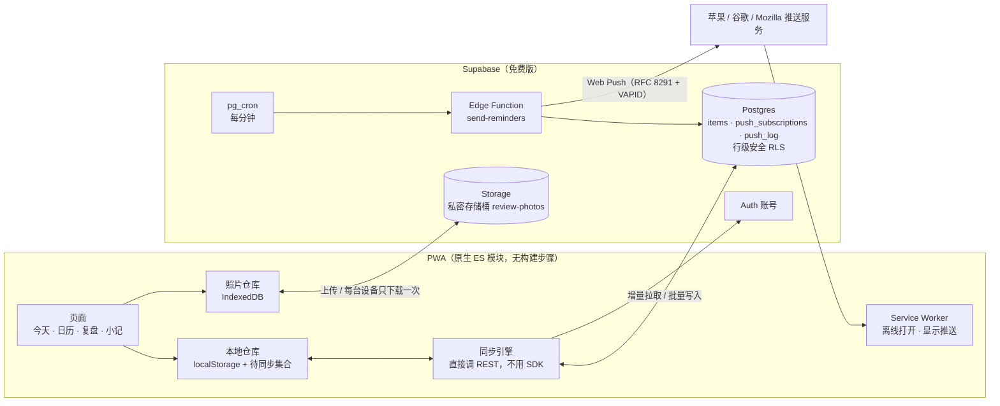

# 日拾 —— 离线优先的每日计划与复盘 PWA

> 一个为自己的日常安排而做的零依赖网页 App：规划一天、坚持每周习惯、追踪截止日期、睡前写几句复盘。断网也能用，iPhone、iPad、Mac 三端同步，**App 关着也能在 07:30 和 23:00 收到服务器推送的提醒**，全部跑在免费额度上。

**语言：**[English](README.md) | 简体中文

    

<!-- TODO(shary): 截图 docs/screenshots/{day,calendar,review,timeline}.png
<table>
  <tr>
    <td></td>
    <td></td>
    <td></td>
    <td></td>
  </tr>
  <tr>
    <td align="center">今天</td><td align="center">今日复盘</td><td align="center">日历</td><td align="center">截止时间轴</td>
  </tr>
</table>
-->

---

## 为什么做它

我同时在准备考试、留学申请和毕业设计，想要一个和自己的计划习惯完全吻合的工具：一次写完一整天、每周固定的事不用重复输入、早晚各提醒一次、能回头看自己做过什么。现有的 App 要么太重，要么手机、平板、电脑之间同步不好，于是自己做了一个。

## 功能

| 模块 | 说明 |
|---|---|
| **今天** | 一次写完一天的任务（每行一个，时间可不填），自动排成按时间的时间线，点圆圈完成 |
| **每周固定** | 按星期和时间段重复；可以只改某一天、跳过、设休息日、暂停一段时间；修改安排只影响以后 |
| **截止时间轴** | 倒计时时间线，截止前 7、5、2 天和当天提醒 |
| **今日复盘** | 心情、今天的感受、小错误、想对明天说的话（边写边自动保存），最多 3 张照片 |
| **小记** | 灵感（待定 → 可行 / 已执行 / 已修改 / 放弃）和随手记，都能安排到某一天 |
| **日历** | 周一开头、最新的月份在最上面；每天显示任务、心情和 📷 |
| **提醒** | 07:30 推送今日任务和截止提醒，23:00 推送未完成任务和复盘提醒，按每个用户的时区计算 |
| **账号** | 邮箱注册、找回密码、多设备同步、自助注销 |

## 系统架构



## 技术亮点

### 1. 不依赖 SDK 的离线优先同步

所有数据存在**一张通用表**里：`items(id, type, data jsonb, updated_at, deleted, server_updated_at)`。之后加新功能（固定任务、小记、复盘、照片）都不需要改表结构。

- **本地优先**：每次修改先写进 `localStorage`，并把 id 加入"待同步集合"，界面从不等网络。
- **推送**：待同步的数据每 200 条一批，用 `upsert … on conflict (id)` 写入；id 是客户端生成的 UUID，离线新建也不会冲突。
- **增量拉取**：数据库触发器给每次写入打上 `server_updated_at = clock_timestamp()`，客户端只拉上次游标之后的数据。游标特意用**服务器时间**，因为不同设备的时钟不可靠。
- **删除用墓碑标记**（`deleted = true`），一台设备上的删除能同步到其他设备。
- **冲突处理**：按 `updated_at` 整条记录"最后写入者胜"（Last-Write-Wins）。
- **换账号登录**：本机属于另一个账号的数据会被清掉，而不是上传到新账号里。
- 本地修改后 1.5 秒、回到前台、恢复联网、每 60 秒，各自动同步一次。

### 2. 按 RFC 自己实现的定时 Web Push

依赖页面开着的提醒在手机上很不可靠，所以改由服务器发送：

- `pg_cron` 每分钟调用一次 Edge Function，用共享口令 `x-cron-secret` 验证。
- 函数按**每个用户自己的时区**（`Intl.DateTimeFormat`）算出当地时间，判断该不该发早上或晚上的提醒，再用和客户端相同的规则生成内容。
- **每天只发一次**：发送前先往 `push_log` 插入 `(user_id, kind, day)`。主键让这次插入相当于一把锁，`on conflict do nothing` 保证即使两次定时任务重叠，也只有第一次能发。
- **不用任何推送库**：消息加密（**RFC 8291**，`aes128gcm`：ECDH P-256 → HKDF → AES-128-GCM）和服务器身份认证（**RFC 8292 VAPID**，ES256 签名的 JWT）都直接用 WebCrypto 实现，函数在 Deno 上零依赖运行。
- 推送服务返回 404/410 的失效订阅会被自动删除。
- 没开推送权限时退回到页面内提醒；开了服务器推送就关掉页面内提醒，避免同一条提醒收到两次。

### 3. 保留历史的每周固定任务

每周固定任务是一个**模板**（`days`、`time`、`from`、`until`、`pauseFrom/To`）。它在某一天的实例是**算出来的**，不存储；只有和模板不一样的地方，才存成 id 为 `fx|<模板>|<日期>` 的一条覆盖记录。

- 覆盖记录**只存和模板不同的字段**，所以模板以后再改，用户没单独改过的字段仍会跟着变。
- 在某一天的编辑页删掉固定任务，只会给这一天写入 `skipped: true`。
- **修改安排从不改写历史**：如果模板已经有过去的实例，就在生效日期拆成两段——旧模板 `until = 生效日 − 1`，新模板从生效日开始。已完成的过去日子保持原来的标题和完成状态。
- 休息日和暂停期间不显示任何固定任务，临时任务不受影响。

### 4. 在 1 GB 免费额度内存复盘照片

- 照片在手机上先缩到最长边 1280 像素，编码为 **WebP**（Safari 不支持导出 WebP 时改用 JPEG），一般 100–200 KB。
- 先存进 **IndexedDB**，离线也能显示；后台再上传到**私密**存储桶的 `<用户 ID>/<照片 ID>.<扩展名>`。
- 每台设备每张照片只下载**一次**，之后从本机读取，流量远低于每月 5 GB 的免费额度。
- 删除操作先排队，联网后执行；存储里的文件不会随账号自动删除，所以注销前 App 会先删光这个用户的所有照片。

### 5. 安全设计

- **每张表都开了行级安全（RLS）**；写入时触发器强制把 `user_id` 设为 `auth.uid()`，客户端伪造这个字段也写不进别人的数据。
- 需要特权的操作（`delete_my_account`、`save_push_subscription`）是 `SECURITY DEFINER` 函数，并撤销了 `public` / `anon` 的执行权限。
- `push_log` 开了 RLS 但不加任何规则，只有服务器（service role）能读写。
- 存储规则把每个操作限制在调用者自己的文件夹（`storage.foldername(name)[1] = auth.uid()`）。
- 浏览器里只有公开的 publishable key；service role key 和 VAPID 私钥只存在 Edge Function 的 Secrets 里。
- 内容安全策略（`script-src 'self'`）阻止注入脚本；用户输入的文字渲染前都做了 HTML 转义。

### 6. 零依赖、零成本

原生 ES 模块，没有打包工具，不需要 `npm install`。前端是静态托管（Netlify）；后端、账号、存储、定时任务和函数都在 Supabase 免费额度内。相应的取舍见"局限"。

## 技术栈

| 层 | 技术 |
|---|---|
| 前端 | HTML、CSS、原生 JavaScript（ES 模块）、Service Worker、Web Push API、IndexedDB、Canvas |
| 后端 | Supabase：Postgres + 行级安全、Auth、Storage、Edge Functions（Deno、TypeScript）、pg_cron、pg_net |
| 托管 | Netlify（静态） |
| 测试 | `node:test`（Node.js 自带） |

## 目录结构

```
├── index.html, styles.css, manifest.webmanifest, sw.js, _headers
├── js/
│   ├── app.js        路由、事件分发、弹窗
│   ├── views.js      各页面的 HTML 渲染
│   ├── store.js      本地数据仓库 + 业务逻辑（固定任务、截止、复盘）
│   ├── sync.js       账号 + 同步引擎（直接调 Supabase REST）
│   ├── photos.js     照片压缩、IndexedDB 缓存、上传
│   ├── push.js       推送订阅管理
│   └── notify.js     页面内备用提醒
├── supabase/
│   ├── schema.sql, delete-account.sql, push.sql, photos.sql
│   ├── cron.example.sql
│   └── functions/send-reminders/index.ts
├── tests/store.test.js
├── scripts/usage-stats.sql   匿名使用统计（只数数量，不读内容）
└── docs/                     使用指南与配置指南
```

## 快速开始

```bash
# 1. 本地运行（ES 模块需要通过 HTTP 服务器访问）
python3 -m http.server 5173        # 打开 http://localhost:5173

# 2. 测试
npm test                           # Node.js 20+，不需要安装任何包
```

开启同步：新建一个免费的 Supabase 项目，在 SQL Editor 依次运行 `supabase/schema.sql`、`delete-account.sql`、`push.sql`、`photos.sql`，再把项目地址和 **publishable key** 填进 `js/config.js`。服务器推送还需要部署 Edge Function、填 3 个密钥、设置定时任务，见 [`docs/push-setup.zh-CN.md`](docs/push-setup.zh-CN.md)。

## 测试

16 个测试覆盖最容易出错的逻辑：待同步标记与墓碑、云端数据的"最后写入者胜"合并、本地持久化、固定任务按星期和日期范围展开、暂停与休息日、只改某一天的覆盖记录仍跟随模板后续修改、模板拆分保留历史、截止提醒天数、复盘清空规则、日历的显示规则。

## 实际使用

我自己每天用日拾安排日程，在 iPhone、iPad、Mac 之间同步；朋友可以注册各自独立的账号。`scripts/usage-stats.sql` 能生成匿名的使用统计（使用天数、任务数、完成率、复盘篇数），不读取任何内容。

<!-- TODO(shary): 申请提交前，用 scripts/usage-stats.sql 的最新数字补上 -->

## 局限与下一步

- **冲突处理比较粗**：最后写入者胜比较的是**客户端**时间、以**整条记录**为单位。两台设备同时改同一天的复盘可能互相覆盖，时钟不准的设备也可能错误地"胜出"。下一步：改用服务器分配的版本号或混合逻辑时钟（HLC），复盘按字段合并。
- **`localStorage` 上限约 5 MB**：文字数据远远用不到，但把主数据也迁到 IndexedDB 可以彻底去掉这个上限。
- **界面没有自动化测试**，目前只测了业务逻辑。下一步用 Playwright 给主要流程加端到端测试。
- **免费额度的限制**：Supabase 免费项目一周没人使用会被暂停；JSON 导出不包含照片。
